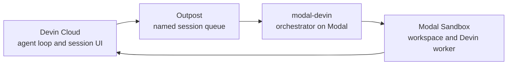

[Devin Outposts](https://docs.devin.ai/cloud/outposts/overview) separates planning
from execution. Devin's agent loop (inference and planning) remains in Devin Cloud,
while command execution, file edits, and repository access happen on compute you
operate.

An **outpost** is a named queue of sessions served by your infrastructure. Following
[Devin's two-layer
model](https://docs.devin.ai/cloud/outposts/overview#how-it-works), Modal provides the
orchestrator through `modal-devin`, and isolated [Modal
Sandboxes](https://modal.com/docs/guide/sandboxes) provide the workers.

## The worker

The worker is Cognition's runtime for serving one queued session. Inside its Sandbox
it executes Devin's tool calls: running commands, editing files, using project tools,
and reaching services allowed by your Modal environment.

The workspace comes from either the current deployed image or a preserved filesystem
from an earlier suspended attempt.

## The orchestrator

The generated Modal application is the orchestrator deployment. It:

- Watches the configured outpost for work.
- Starts one isolated Sandbox for an accepted session.
- Runs the worker and streams its output to Modal logs.
- Preserves the workspace when the session suspends.
- Cleans up compute and makes failed work retryable.

It runs on Modal after deployment. Nothing in the runtime path depends on the local
machine from which you ran `modal-devin init` or `modal-devin deploy`.

Your generated file exposes deployment policy such as images, secrets, compute,
regions, retries, and schedule. The library keeps the Outposts and Sandbox lifecycle
behind the `Worker` API.

## Trust boundary

The raw Devin credential is kept out of the main session environment. The workload
can still use the limited Outposts capability required to serve its assigned session,
so use least-privilege credentials and separate outposts when trust requirements differ.

## Network requirements

Workers need outbound HTTPS access to Devin and run without inbound ports, a public
IP, or a connection initiated from Devin Cloud.

## Operational model

One generated application represents one outpost deployment. Give deployments unique,
durable names so their Modal resources and resumable work remain independent.

<Card title="Session lifecycle" icon="route" href="/explanation/session-lifecycle" horizontal>
  See what happens when a session is queued, runs, suspends, completes, or fails.
</Card>
